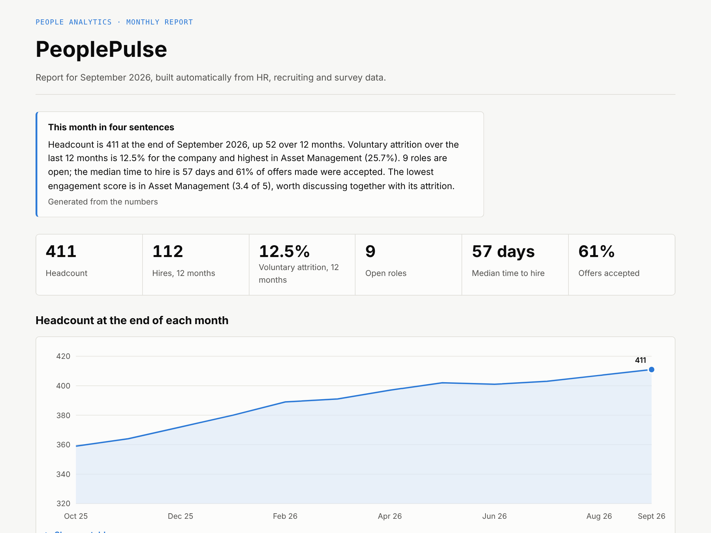
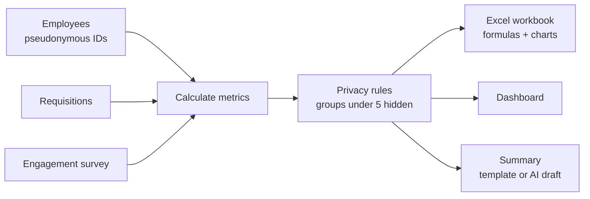
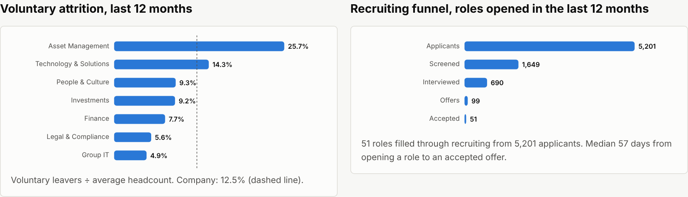

# PeoplePulse

**Turn monthly HR, recruiting and survey data into a people report in one run: an Excel workbook, a dashboard and a short written summary, with privacy safeguards built in.**

Many teams build the same people report by hand every month: export data, update pivot tables, copy numbers into slides and write a summary. PeoplePulse automates that recurring work so the time goes into understanding the numbers instead.



> **Note:** every employee, department, number and survey answer is fictional and generated by `generate_sample_data.py`. Employees have pseudonymous IDs only.

---

## Why I built it

People analytics combines two things I care about: using data and automation to answer real questions, and handling personal data responsibly. I wanted to build a recurring report that is quick to produce, easy to check, and safe by design.

## What it does

| | |
| --- | --- |
| **Headcount and movement** | Headcount at each month end, hires, voluntary and involuntary exits for the last 12 months |
| **Attrition** | Voluntary attrition over 12 months for the company and each department (leavers ÷ average headcount) |
| **Recruiting** | Funnel from applicants to accepted offers, open roles, median days to hire, offer acceptance |
| **Engagement** | Survey scores per department, hidden when too few people answered |
| **Excel report** | A workbook with a summary, a headcount chart, department and recruiting tables using real formulas, and a method sheet |
| **Written summary** | Four sentences generated from the numbers, or an AI-written draft if switched on |

## How it works



### Privacy by design

| Rule | Why |
| --- | --- |
| Pseudonymous IDs only, no names or contact details | People data is personal data under GDPR; analytics does not need to know who someone is |
| Any group under **5 people** is shown as **<5** | Small groups can identify individuals. In the sample, Group IT's engagement score (4 respondents) is hidden |
| Only aggregated numbers leave the tool | Including what an optional AI model receives: never a single employee row |

### Written summary

By default the summary is a template filled with the month's numbers, so it is always correct. With `PEOPLEPULSE_LLM=1` and an `ANTHROPIC_API_KEY`, a language model writes it from the aggregated numbers only, and it is labelled **"AI draft – review before sending"**.



## Results on the sample data (September 2026)

> Headcount is 411 at the end of September 2026, up 52 over 12 months. Voluntary attrition over the last 12 months is 12.5% for the company and highest in Asset Management (25.7%). 9 roles are open; the median time to hire is 57 days and 61% of offers made were accepted. The lowest engagement score is in Asset Management (3.4 of 5), worth discussing together with its attrition.

The sample data contains a built-in story: Asset Management has twice the company's attrition rate *and* the lowest engagement score. A good report should surface that, and this one does.

## Getting started

Requires Python 3.10 or newer.

```bash
git clone https://github.com/Rafia180/peoplepulse.git
cd peoplepulse
python -m venv .venv
source .venv/bin/activate              # on Windows: .venv\Scripts\activate
pip install -r requirements.txt

python run.py --month-end 2026-09-30
python -m unittest -v                  # 7 tests
```

Outputs in `output/`:

| File | What it is |
| --- | --- |
| `people_report_2026-09.xlsx` | Summary, Headcount (with line chart), Departments (attrition formula, bar chart), Recruiting (conversion formulas), Notes & method |
| `dashboard.html` | The same report as an interactive page with hover details and tables |
| `summary.md` | The written summary, ready to paste into an email or slide |
| `departments.csv` | Department metrics, ready for Power BI |

**Optional, AI summary:**

```bash
export ANTHROPIC_API_KEY=your-key
export PEOPLEPULSE_LLM=1
python run.py --month-end 2026-09-30
```

## Project structure

```
peoplepulse/
├── data/
│   ├── employees.csv          pseudonymous ID, department, level, location, hire and exit dates
│   ├── requisitions.csv       roles opened, funnel counts, filled date
│   └── engagement_survey.csv  department-level scores and number of respondents
├── peoplepulse/
│   ├── metrics.py             headcount, attrition, recruiting, gender share by level
│   ├── privacy.py             minimum group size and suppression
│   ├── narrative.py           template summary and optional AI draft
│   ├── excel.py               the Excel workbook with formulas and charts
│   └── report.py              builds everything
├── templates/dashboard.html
├── tests/
├── generate_sample_data.py
└── run.py
```

## How I built it

I built PeoplePulse with an AI coding assistant as a pair programmer. The AI wrote most of the code. My part was:

1. Choosing the questions a monthly people report should answer, and the privacy rules from my data protection studies.
2. Designing sample data with a story in it, so the report can show it finds what matters.
3. Checking the numbers. I caught that the first funnel showed more accepted offers than hires, because the sample data allowed several accepted offers per role. I fixed the data so each filled role has one accepted offer.
4. Checking that the Excel formulas recalculate to the same values as the tool.

## Limitations and next steps

- Attrition uses the average of two points (12 months ago and today); a monthly average is more precise for fast-growing teams.
- Next: a Power BI version reading `departments.csv`, and a PowerPoint export of the summary page.

## Author

**Rafia Tasnim**, BSc Computer Science student, Niels Brock Copenhagen Business College
[LinkedIn](https://www.linkedin.com/in/rafia-tasnim26) · [GitHub](https://github.com/Rafia180)
